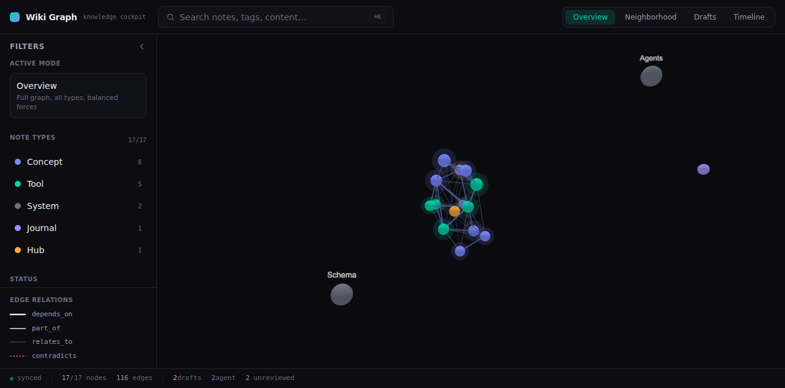

# Wiki Graph — Knowledge Cockpit

A 3D knowledge graph web UI that turns an Obsidian vault into an interactive, explorable second brain. Built for engineers and researchers who manage interconnected knowledge and want to *see* how ideas connect — not just read about them.



## Live Demo

**[wiki-graph.joestechsolutions.com](https://joestechsolutions.github.io/wiki-graph-ui/)**

## What It Does

- **3D force-directed graph** of your entire vault — nodes are notes, edges are typed relationships (`depends_on`, `part_of`, `relates_to`, `supersedes`)
- **Four exploration modes:** Overview (full graph), Neighborhood (2-degree around a node), Drafts (review workflow), Timeline (recency-arranged)
- **Click to inspect** — right panel shows summary, tags, relations, backlinks, markdown preview, and an "Open in Obsidian" deep link
- **Path tracing** — shift-click two nodes to highlight the shortest path between them
- **Live filtering** — by node type, status, recency, and full-text search
- **Mobile responsive** — slide-in panels, hamburger nav, touch-friendly canvas

## Tech Stack

| Layer | Choice | Why |
|-------|--------|-----|
| Framework | Next.js 14 (App Router) | Static export, TypeScript, fast builds |
| Graph Renderer | react-force-graph-3d / Three.js | GPU-accelerated force-directed layout |
| Styling | Tailwind CSS | Utility-first, dark theme, no CSS bloat |
| Data | Build-time JSON import | No runtime fetch, no backend, no API |
| Labels | three-spritetext | 3D sprite labels that scale with zoom |

**No backend. No auth. No database.** The vault is parsed to JSON at build time and baked into the static bundle. Deploy anywhere that serves HTML.

## Architecture

```
Obsidian Vault (~/wiki)
    │
    ▼
sync-vault.py ── parses frontmatter + wikilinks ──▶ graphData.json
    │
    ▼
Next.js build ── imports JSON at build time ──▶ static export (out/)
    │
    ▼
GitHub Pages / any static host
```

```
src/
  app/
    layout.tsx          — root layout, fonts, dark theme
    page.tsx            — orchestrator: state, filters, graph modes, selection
    globals.css         — Tailwind + theme tokens + touch handling
  components/
    Graph3D.tsx         — react-force-graph-3d wrapper (lazy-loaded, ssr:false)
    LeftSidebar.tsx     — filters, mode info, legend (mobile: slide-in overlay)
    RightPanel.tsx      — note details, relations, backlinks, Obsidian deep link
    CommandBar.tsx      — search with ⌘K, mode switcher, hamburger toggle
    BottomTray.tsx      — sync status, node/edge counts (responsive trim)
  lib/
    types.ts            — GraphNode, GraphLink interfaces
    graphData.ts        — loads + normalizes graphData.json
    filters.ts          — filter + search logic
    graphModes.ts       — mode definitions + force presets
    pathfinding.ts      — BFS shortest path between nodes
    markdown.ts         — minimal markdown renderer for preview
    theme.ts            — node colors, status styles
scripts/
    sync-vault.py       — vault parser → graphData.json (with security denylist)
```

## Getting Started

### Prerequisites

- Node.js 20+
- An Obsidian vault with markdown notes (frontmatter + wikilinks)

### Install

```bash
git clone https://github.com/joestechsolutions/wiki-graph-ui.git
cd wiki-graph-ui
npm install
```

### Sync your vault

```bash
python3 scripts/sync-vault.py ~/your-vault > public/graphData.json
```

The sync script reads YAML frontmatter, extracts typed relations, wikilinks, and backlinks. It includes a **security denylist** that automatically skips notes containing phone numbers, emails, API keys, private keys, SSNs, or compensation figures.

### Run

```bash
npm run dev    # development
npm run build  # production → out/
```

### Deploy to GitHub Pages

```bash
# Build the static export
npm run build

# Push out/ to gh-pages branch
npx gh-pages -d out
```

Or use the included GitHub Action (see `.github/workflows/deploy.yml`).

## Node Types & Colors

| Type | Color | Description |
|------|-------|-------------|
| Tool | `#00d4aa` (teal) | Software tools, platforms, services |
| Concept | `#7c8aff` (periwinkle) | Ideas, architectures, methodologies |
| Hub | `#ffaa3d` (amber) | Index pages, navigation hubs |
| System | `#6b7280` (gray) | System config, infrastructure |
| Journal | `#a78bfa` (purple) | Logs, changelogs, journals |
| Draft | `#f59e0b` (amber-orange) | Unreviewed agent output |

## Security

- **Denylist guard** in `sync-vault.py` — scans every note for sensitive patterns before publishing
- **Directory exclusions** — `.obsidian`, `.git`, `private/`, `personal/`, `secrets/` are never synced
- **Preview sanitization** — any accidental sensitive data in note previews is replaced with `[REDACTED]`
- **No runtime data fetch** — all data is baked at build time, no exposed API endpoints
- **Static-only** — no server, no auth surface, no attack surface

## License

MIT — see [LICENSE](LICENSE).

---

Built by [Joe's Tech Solutions LLC](https://joestechsolutions.com) · [GitHub](https://github.com/joestechsolutions)